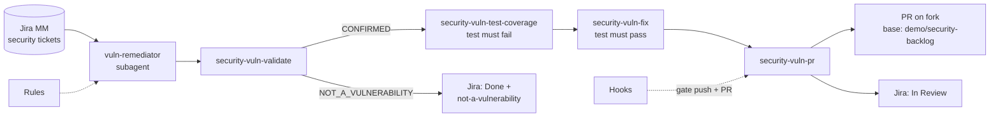

# Demo: burning down a security backlog with Cursor

> **This branch contains intentionally planted security vulnerabilities.** They exist only on `demo/security-backlog` of the `quinndarling21/mattermost` fork, for demonstration purposes. Never merge this branch into `master` or upstream.

This demo shows Cursor working a backlog of security vulnerabilities that live in Jira. A single subagent takes each ticket through four skills (validate, reproduce with a failing test, fix against that test, open a PR), while rules and hooks enforce the team's standards along the way.

## How it fits together



| Piece | Path | Status |
| --- | --- | --- |
| Backlog rule | `.cursor/rules/security-backlog.mdc` | Prebuilt |
| **Secure fix standards rule** | `.cursor/rules/secure-fix-standards.mdc` | **Built live** |
| **Validate skill** | `.cursor/skills/security-vuln-validate/` | **Built live** |
| Test coverage skill | `.cursor/skills/security-vuln-test-coverage/` | Prebuilt |
| Fix skill | `.cursor/skills/security-vuln-fix/` | Prebuilt |
| PR skill | `.cursor/skills/security-vuln-pr/` | Prebuilt |
| PR target guard hook | `.cursor/hooks/guard-shell.sh` | Prebuilt |
| **Regression test gate hook** | `.cursor/hooks/require-security-tests.sh` | **Built live** |
| **Orchestrator subagent** | `.cursor/agents/vuln-remediator.md` | **Built live** |
| Setup and reset | `.cursor/skills/setup-demo-security-backlog/`, `.cursor/skills/reset-demo-security-backlog/` | Prebuilt |

The backlog lives in Jira project `MM` under the **Security vulnerability backlog** epic ([MM-3](https://quinnsworkspace-610b13be.atlassian.net/browse/MM-3)), on [board 1](https://quinnsworkspace-610b13be.atlassian.net/jira/software/projects/MM/boards/1). Open tickets: `project = MM AND labels = security AND status = "To Do"`.

| Ticket | Summary | Priority |
| --- | --- | --- |
| [MM-4](https://quinnsworkspace-610b13be.atlassian.net/browse/MM-4) | OAuth redirect URI allowlist bypassed by single-wildcard matching | Highest |
| [MM-5](https://quinnsworkspace-610b13be.atlassian.net/browse/MM-5) | Team allowed-domain restriction bypassed with lookalike email domains | High |
| [MM-6](https://quinnsworkspace-610b13be.atlassian.net/browse/MM-6) | Stored XSS via javascript: link in message attachment title_link | High |
| [MM-7](https://quinnsworkspace-610b13be.atlassian.net/browse/MM-7) | Account creation domain restriction uses suffix matching (CheckEmailDomain) | Medium |

## Before the demo

In a new Agent chat, run:

```text
/setup-demo-security-backlog
```

It checks out a clean baseline, makes sure Postgres and the server are healthy, confirms the Jira tickets are in **To Do**, and warms the Go and Jest caches so test runs take seconds.

Log in to the local app at http://localhost:8065 as `admin` / `admin` if you want to show the product.

## Live build

Create the four pieces in this order. Each prompt uses one of Cursor's built-in creation skills. Paste a prompt into Agent, review what it writes, and accept.

### 1. Rule: secure fix standards

```text
/create-rule Create a project rule at .cursor/rules/secure-fix-standards.mdc with our secure coding standards for security fixes. Scope it to server/**/*.go, webapp/**/*.ts and webapp/**/*.tsx (not always-on).

Cover:
- Every security fix ships with a regression test that failed before the fix and passes after it.
- Never delete, skip, or loosen an existing test or assertion to make a fix pass.
- Validate untrusted values with exact comparisons on parsed values, not prefix/suffix/substring checks on raw strings.
- Prefer allowlists over denylists.
- Fix the root cause at the validation boundary, not with an extra check downstream.
- Errors and logs must not echo secrets, tokens, or full untrusted payloads.
- No new dependencies for a security fix.

Include short bad/good code examples in Go and TypeScript using generic cases (path containment, hostname comparison, URL protocol allowlist). Keep it under 50 lines.
```

### 2. Skill: validate the vulnerability

```text
/create-skill Create a project skill called security-vuln-validate in .cursor/skills/. It is the first step for any Jira security ticket in project MM, before anyone writes tests or code. Allow automatic invocation.

The skill should:
1. Fetch the ticket with the Atlassian MCP (cloudId bd7dc254-ec63-4026-9f13-d97c51fb68ad) and extract the reported file and function, vulnerability class and CWE, attacker-controlled input, and claimed impact. Read existing comments too, as context rather than proof.
2. Read the reported code and its callers, and trace the attacker-controlled input to the vulnerable check or sink.
3. Build a concrete exploit input and work through what the current code does with it. Check reachability and whether another layer already blocks it.
4. Decide a verdict: CONFIRMED (you can name an input and the line that accepts it), NOT_A_VULNERABILITY (the input is blocked or the path is unreachable), or NEEDS_INFO. Never confirm from pattern-matching alone. If the check is weaker than intended but a later layer blocks the input, it is NOT_A_VULNERABILITY, and the comment should recommend a hardening follow-up naming the weak line.
5. Update Jira. CONFIRMED: comment with evidence and move to In Progress. NOT_A_VULNERABILITY: comment with evidence, add the label not-a-vulnerability, and move to Done. NEEDS_INFO: comment with questions and leave it in To Do.

End with a fixed output block (VERDICT, Ticket, Location, Class with CWE, Exploit input, Current behavior, Expected safe behavior, Evidence) that the security-vuln-test-coverage skill consumes.
```

### 3. Hook: no push without a proven fix

```text
/create-hook Create a project hook that blocks `git push` and `gh pr create` on security/* branches unless the ticket's regression test proves the fix.

- Event: beforeShellExecution. Add it to .cursor/hooks.json alongside the existing guard-shell.sh hook (keep that one), with a 180 second timeout.
- Script: .cursor/hooks/require-security-tests.sh, using jq.
- Allow any command that is not a push or PR create, and anything on a branch that does not start with security/.
- Read the ticket key from the branch name (security/MM-12-slug -> MM-12) and load .cursor/security-evidence/<KEY>.json.
- Deny if the file is missing or red.result is not "fail" (the test was never shown failing).
- Only run test_command if it starts with "cd server && go test " or "cd webapp/channels && npx jest ".
- Run it. If it fails, deny and include the last 20 lines of output in the agent message. If it passes, allow with a user message saying the regression test passed.

Make the script executable and test it with a fake evidence file before finishing.
```

### 4. Subagent: the orchestrator

```text
/create-subagent Create a project subagent called vuln-remediator in .cursor/agents/ that remediates one Jira security ticket end to end. Make its name and description clearly different from the existing security-reviewer subagent.

- Input: a ticket key, or otherwise the first result of: project = MM AND labels = security AND status = "To Do" ORDER BY priority DESC (Atlassian MCP, cloudId bd7dc254-ec63-4026-9f13-d97c51fb68ad).
- Start from an up-to-date demo/security-backlog branch. Stop if there are uncommitted changes outside .cursor/ (changes inside .cursor/ are expected and must never be committed with a fix).
- Follow .cursor/skills/security-vuln-validate/SKILL.md. Stop and report unless the verdict is CONFIRMED.
- Follow .cursor/skills/security-vuln-test-coverage/SKILL.md. Stop if the new test does not fail.
- Follow .cursor/skills/security-vuln-fix/SKILL.md. Never edit a test to make it pass.
- Follow .cursor/skills/security-vuln-pr/SKILL.md to open the PR and move the ticket to In Review.
- If a hook blocks a command, fix the underlying problem and retry; never work around a hook.

Final report: ticket and verdict, root cause in one or two sentences, regression test before/after, PR URL and Jira status, and anything deliberately left out of scope. If it stopped at validation, report the verdict, Jira status, and any hardening follow-up instead of the test and PR lines.
```

## Run the demo

Work one ticket:

```text
Use the vuln-remediator subagent to remediate the highest-priority open security ticket in Jira.
```

Or name a ticket:

```text
Use the vuln-remediator subagent to remediate MM-<number>.
```

Then work the rest of the backlog, one ticket at a time (the tickets share one working tree, so do not run them in parallel locally):

```text
Use the vuln-remediator subagent to work through every remaining open security ticket in Jira, one at a time, and give me a summary table at the end.
```

Things worth pointing out as it runs:

- **Validation is real judgment.** Not every scanner report is a real bug; watch for a ticket closed with evidence instead of "fixed".
- **Red, then green.** The test skill shows the new test failing against the vulnerable code before the fix skill touches anything.
- **Guardrails fire visibly.** The regression test gate re-runs the test before every push, and `guard-shell.sh` blocks any PR that does not target the fork and `demo/security-backlog`.
- **Jira stays current.** Each ticket gets an evidence comment and moves through In Progress and In Review.

To show a guardrail on purpose:

```text
Open a PR for the current branch with gh pr create, without passing --repo.
```

## Reset between runs

```text
/reset-demo-security-backlog
```

This closes the fix PRs, deletes `security/*` branches, removes the four live-built files and local test evidence, and moves the Jira tickets back to **To Do**.

## Fallback

Finished versions of the four live-built pieces, plus presenter notes, are kept outside the repo at `~/Code/Demo/security-backlog-demo-golden/`. If a live creation goes wrong:

```bash
cp -R ~/Code/Demo/security-backlog-demo-golden/.cursor/. .cursor/
chmod +x .cursor/hooks/require-security-tests.sh
```

## Troubleshooting

- **Every login fails but the server answers pings.** Postgres is down. Run `docker start mattermost-postgres mattermost-redis`.
- **A new hook does not fire.** Cursor reloads `hooks.json` on save; if it still does not fire, check **Cursor Settings → Hooks** or restart Cursor.
- **Jira calls fail.** Re-authenticate the Atlassian connector in Cursor settings.
- **`TestUpdateAssetsSubpath/no_client_dir` fails** in `server/channels/utils`. This is an existing, unrelated failure on this machine; the fix skill treats it as pre-existing.
